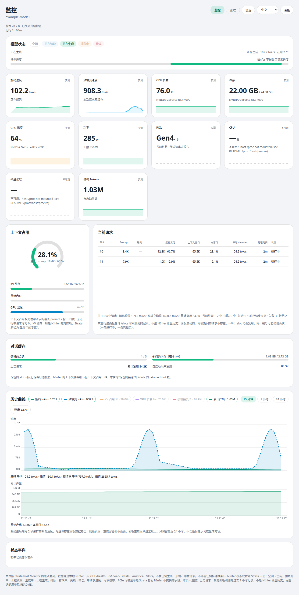
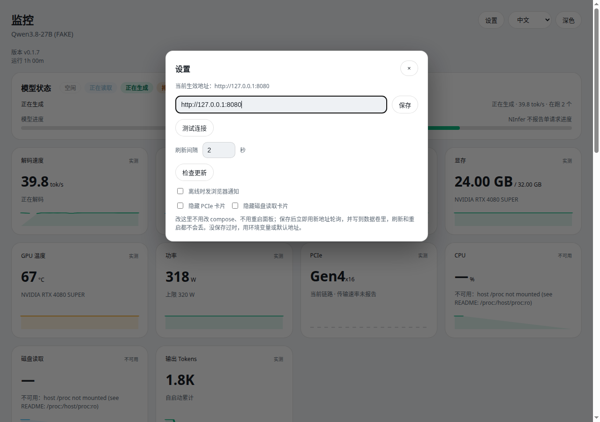
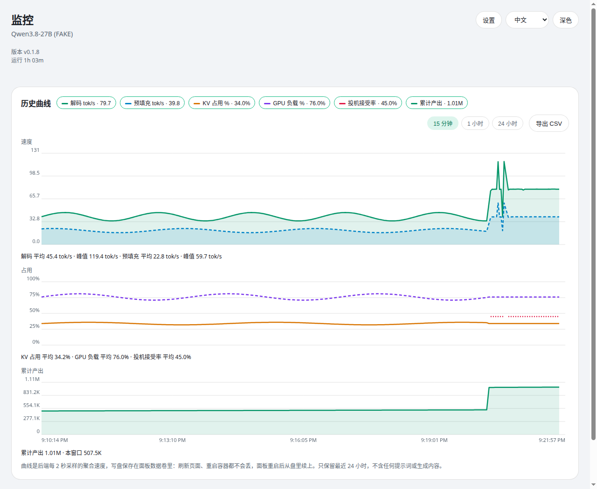
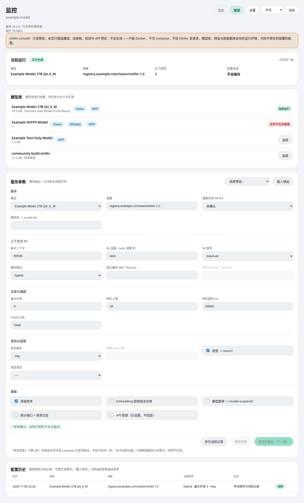
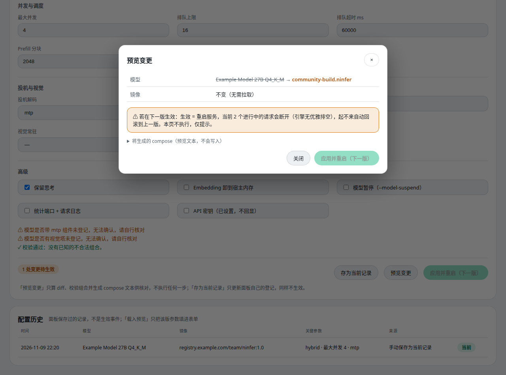

# ninfer-console

[中文](./README.md) | English

A web console for an already-running NInfer server, with two faces on one page:

- **Monitor view**: a read-only live panel — engine state, speeds, VRAM, requests, and history curves.
- **Manage view**: pick a model, edit parameters, validate combinations, inspect the diff and the compose that would be generated. Parameter edits are **never applied**: no Docker access, no writes to the engine's files. The one real action is **model switching**: when the engine runs in router mode, “Switch” in the model library goes through the engine's own `/models/load` API, executed by the engine itself. There are no standalone sleep / unload / wake controls and nothing switches automatically.

Both views follow the same rule: **report only what is measured; when something cannot be measured, say "unavailable" instead of inventing a number**. And the code contains **no deployment's configuration** — the model library, presets, the config on record, and the limits all come from your running environment (the models directory, data files you maintain, and values measured from the engine and the host).

- **Image**: `ghcr.io/izerok/ninfer-console:latest` (built and pushed by GitHub Actions on every push to main; tags `latest` + `v<VERSION>`).
- **Zero third-party dependencies**: Python 3.12 standard library plus a static page; bilingual UI (中文 / English), dark and light themes.

## Screenshots (actual runs)

Every screenshot below was captured from this repository's code actually running (light theme, Chinese UI). The backend is a simulated NInfer and the models/data are the sample entries from `examples/` (the GPU is a sample value too). The CPU / disk cards show "unavailable" because the screenshot environment had no host `/proc` mount — which is exactly how the panel reports anything it cannot measure.

<table>
  <tr>
    <td align="center"><br>Monitor: main panel</td>
    <td align="center"><br>Settings dialog</td>
  </tr>
  <tr>
    <td colspan="2" align="center"><br>History, three panels: speed / usage / cumulative output (15 minutes by default)</td>
  </tr>
  <tr>
    <td colspan="2" align="center"><br>Manage view: running card (cross-checked against live readings) / model library (discovered + registered, merged) / parameter form / config history</td>
  </tr>
  <tr>
    <td colspan="2" align="center"><br>Change preview: diff + interruption warning; a model with undeclared capabilities gets warnings, never a fabricated verdict</td>
  </tr>
</table>

## Quick start

```bash
# With the bundled compose file (builds locally):
docker compose up -d

# Or pull the GHCR image directly:
docker run -d --name ninfer-console -p 127.0.0.1:8091:8091 \
  -v ninfer-console-data:/app/data \
  ghcr.io/izerok/ninfer-console:latest

# Or from source (Python 3.12 only):
python3 app.py
```

Open http://127.0.0.1:8091/ . The console is published to the host loopback only by default; do not change it to `0.0.0.0` for public exposure (see [Security](#security)).

- **Point it at your NInfer**: use the Settings dialog (takes effect immediately), or set `NINFER_BASE_URL` as the first-run default.
- **Let the Manage view see your models**: mount the models directory read-only and set `PANEL_MODELS_DIR` (the bundled compose file has a commented-out pair of lines for exactly this).
- **Register model capabilities / presets**: rename `examples/models.example.json` and `examples/presets.example.json` into the data volume and edit them (or point `PANEL_MODELS_FILE` / `PANEL_PRESETS_FILE` elsewhere).

## Monitor view

| Section | Content |
| --- | --- |
| Model state | Five states: idle / reading / generating / queued / error (NInfer has no single state field; mapped from running / waiting / prefilling / decode_ready). |
| Metric cards | Decode, prefill, GPU load, VRAM, temperature, power, PCIe, CPU, disk read, output tokens (cumulative decode count since startup). Sparklines resume from backend history after refresh (PCIe has link info only, so its sparkline stays dashed; PCIe and disk read can be hidden from Settings). |
| Current requests | Top rows are in-flight slots: slot id, prompt length, output (not reported while in flight), cached portion (length · share of prompt), context window, share of window, average decode, duration, "In flight". Grey rows below are requests that ended in the past hour. By default they come from the panel's own /slots observation records (lengths only; slot ids are reused): average decode is the panel-wide average decode rate over the request's processing window (not the request's own speed), and duration is the observed first-to-last span. If NInfer is started with `--request-log-jsonl` and the log file is mounted read-only into the panel with `PANEL_REQUEST_LOG` set, the grey rows instead use the log's real completion records: real output token counts, average decode as the request's own speed (output ÷ decode time), duration as TTFT + decode time (hover for the queue/decode breakdown), the finish reason in the status, and the reuse path on the cached cell's hover. Queued requests are a count only. The table body is capped at 320px and scrolls internally; the totals line stays outside the scroll area and always visible (failed/rejected counts are appended when above zero). |
| Context usage | Longest in-flight prompt / window limit (`capacity.max_context` from `/v1/load`), plus KV cache, system memory, and GPU temperature rows. |
| Conversation cache | Retained slot count and host KV (filled from the same-named /stats fields when /v1/load leaves them empty), plus cumulative reused tokens. Builds that report context_cache also get three cumulative lines: pressure (evictions / demotions / spill pages / dropped checkpoints), the reuse-path distribution, and device↔host transfer volumes. |
| History | Three stacked panels sharing one time axis: speed (decode, prefill tok/s), usage (KV, GPU, speculative acceptance %, lines only, no fill), and cumulative output (cumulative decode tokens, breaking — not cliffing — when an NInfer restart resets the counter). Six legend dimensions toggle (stored in the browser) with latest values; turning off every dimension of a panel hides that panel; each panel has its own window stats (speed: average/peak; usage: average; cumulative output: “Cumulative X · This window Y”); lines within a panel use solid, dashed and dotted styles, so series are never distinguished by color alone. Default range 15 minutes; switches to 1 hour / 24 hours (plus 7 days when retention reaches it); hover shows values at that moment; Export CSV columns follow the legend selection (the cumulative column appears only when that dimension is on). Sampled every 2 seconds and persisted to disk, so it survives refreshes, restarts, and recreates (with the data volume mounted); only the last 24 hours are kept (configurable). When the data span is shorter than the window, the axis fits the data so the curve always fills the chart, and time ticks adapt to the span. |
| State events | State changes seen by backend polling (time, old → new, reason), capped at 200 entries in the data volume; the curve marks each moment with a vertical line (offline red, recovery green, other grey). |

### Settings

The top-right Settings dialog edits the NInfer address; saving takes effect immediately — no compose edit, no restart. Precedence: **UI-saved > `NINFER_BASE_URL` > image default**. It also offers Test connection (`/health` only, no API key, never auto-saves), a refresh interval (1–10 s, display only), a manual Check for updates (bypasses the 1-hour cache), "Notify in browser when offline" (off by default), and "Hide PCIe card" and "Hide disk read card" (both off by default, this browser's view only). The saved value lives in `settings.json`.

Top-right buttons switch dark / light and 中文 / English, stored in browser `localStorage`; before a choice, the theme follows the system and the language follows the browser. All UI strings come from one dictionary in `web/i18n.js`; `web/index.html` contains none.

## Manage view

The header switches between Monitor and Manage. Pick a model, edit parameters, validate, and inspect the diff — parameter edits are never applied: no Docker access, no compose writes, and the "Apply & restart" button is disabled. **Model switching is a real action** (next section), through the engine's own router API.

**No deployment's configuration is built into the code.** The model library, presets, the config on record and the limits all come from the running environment:

- **Config on record**: the record you saved with "Save as current record" wins; before that, a record is derived from the live engine snapshot (only the fields NInfer itself reports — model, max context, max concurrency — labelled as snapshot-derived); with the engine offline it is a blank config. The running card cross-checks the record against `/v1/load` and flags mismatches instead of hiding them.
- **Model library**: two sources merged — the `*.ninfer` files actually present in the read-only mounted models directory (`PANEL_MODELS_DIR`; sizes measured, capabilities unknown), plus entries you register in a `models.json` data file, which is the only place capabilities (vision tower, MTP/DFlash2 components, an NVFP4 requirement) can be declared. See `examples/models.example.json` for the format. A malformed file never crashes anything: bad entries are ignored and every problem is listed at the top of the page.
- **Parameter form**: one backend `PARAM_SCHEMA` (`console_core.py`) drives the form, validation, the diff and compose generation, so the four can never drift. The compatibility engine's rule: **a declared capability that conflicts is a hard error** (vision on a model declared visionless, an NVFP4-requiring model with the image marked as not supporting it); **an unknown capability is a warning**, never a fabricated verdict. Structural rules (hybrid/catalog mixing, draft tokens without dflash2, …) are always enforced.
- **Runtime-measured limits**: the host-cache cap is a quarter of measured host RAM (with the `/host/proc` mount, or an explicit `PANEL_HOST_CACHE_MAX_MIB`), and the VRAM budget is the GPU's measured total memory. When a limit cannot be measured, that check is skipped rather than guessed.
- **Presets**: your own `presets.json` data file (see `examples/presets.example.json`); none are built in. A command-array import endpoint (`POST /api/console/import`) also exists — paste the serve command from your existing compose file to fill the form.
- **Preview changes**: the diff (old → new; an unchanged image is stated too), the interruption warning (applying means a restart; in-flight requests are cut), and the full compose text that would be generated (fixed structure, schema-only variation) — for review only, never written anywhere.
- **Draft and history**: form edits auto-save to a draft in the data volume (`console_draft.json`) and survive refreshes; every saved current record also lands in the history (records, not apply events), and any version can be loaded back into the form as a preview.
- **Import / export config**: the "Config data" card at the top of the Manage view exports one JSON bundle — registered models, presets, and the saved current record, with a format marker and a bundle version (models-directory discoveries are machine state and stay out). Import overwrites those three section by section and reports each: bad entries are skipped with reasons, a wrong format or unsupported version refuses the whole file, and a bundled current record must pass validation before it is recorded. Use it for backups, moving to a new host, or syncing a second panel. The older command-array import (`POST /api/console/import`) remains — that one turns an existing serve command back into form values, a different job.

- **Model switching (router mode)**: when the engine is started as a router (`ninfer-serve --models-dir … --models-preset … --model-suspend`), the panel polls `GET /models` for every model's live state (loaded / sleeping / unloaded / loading), and each model that is not serving carries exactly one button: **Switch**. A switch goes through `POST /api/console/model-action`, which forwards to the engine's `POST /models/load` with the panel's configured API key; the engine loads the target and displaces the current model — parked asleep with `--model-suspend` (state and conversations kept, only GPU memory returned, so switching back wakes it in seconds) or unloaded without it. The engine's answer is reported verbatim. **One action by design**: the panel offers no standalone sleep / unload / wake, and no idle auto-sleep timer is configured on the engine either — if nobody clicks, nothing ever switches. The lifecycle belongs entirely to the engine: the panel touches no Docker and restarts nothing. When the engine is not in router mode, the library says so plainly instead of pretending. In router mode with no model serving, the Monitor view shows a "router" state rather than a false offline. Per-model parameters in router mode live in the engine's preset file sections; changing them still means editing that file and restarting the engine once — outside what this page applies.

Endpoints: `GET /api/console`, `GET /api/console/export`, `GET /api/console/router`, `POST /api/console/preview`, `POST /api/console/import`, `POST /api/console/import-bundle`, `POST /api/console/draft`, `POST /api/console/current`, `POST /api/console/model-action`. Logic tests live in `tests/test_console_core.py` (`python3 -m unittest discover -s tests`) and use synthetic fixtures only.

## Data sources and definitions

The Monitor view only ever issues GETs to NInfer (the Manage view's model switching is the single exception, above):

| Endpoint | Used for |
| --- | --- |
| `/health` | Online or not, version |
| `/v1/load` | Model, uptime, capacity, admitted / running / waiting / prefilling / decode_ready, KV usage, cumulative counts |
| `/stats` | Cumulative averages, queue depth, peak admitted |
| `/metrics` | Requests completed / failed / rejected, KV usage ratio, draft accept rate, cumulative average speeds |
| `/slots` | Slot totals, in-flight and retained counts; in-flight slots' prompt lengths and cached portions |
| `nvidia-smi` | GPU load, VRAM, temperature, power (needs the NVIDIA container toolkit and GPU passthrough; otherwise unavailable) |
| Host `/proc` (read-only mount) | System memory, CPU, disk throughput (without the mount: unavailable; container numbers are never substituted) |

Three speeds, kept apart: **instant** ((this − last) / interval from counters sampled every 2 seconds), **15-minute average** (counter samples kept for 900 seconds), **cumulative average** (NInfer's own since-startup average from `/metrics` / `/stats`).

## What is deliberately not invented

Fields the engine does not have are never fabricated:

- **Per-request progress**: `/slots` does not report it, so the progress bar only animates while reading / generating, never showing a fake percentage.
- **Request history**: NInfer has no history API, so the grey rows are records the panel itself observed by polling `/slots` in the past hour, not native history; requests from before the panel started or while it was down do not exist and are not backfilled.
- **Experts in VRAM**: a MoE cache concept from other engines that NInfer does not have; the context section uses NInfer's KV cache instead.
- **PCIe transfer rate**: not reported by NInfer, and a single `nvidia-smi` query only gives link generation / width, so the PCIe card shows the link and says the rate is not reported.
- **Generated token counts**: `/slots` has none, so the current-requests table shows prompt length only, not output tokens.
- **Model component capabilities**: files discovered in the models directory are "undeclared" — the Manage view warns instead of concluding; only capabilities you declared in `models.json` take part in hard-error checks.
- **Unreachable fields**: shown as "unavailable", never as 0 (0 would be misread as a measured value).

## Number display rules (display only, values unchanged)

- Speed is always `tok/s`, never `t/s`; decode at or above 1000 shortens to `k tok/s` (e.g. 1.23k tok/s), prefill is always raw, never shortened to k (e.g. 1245.3 tok/s).
- The cached column shows "length · share of prompt" (for example 4K · 33.3%).
- Token counts at or above 1000 shorten to K/M (e.g. 12K, 262.1K); the exact value stays in the hover tooltip and raw `/api/snapshot` numbers.
- Bytes auto-scale B / KB / MB / GB; at or above 1024 MB/s the rate switches to GB/s; percentages always 1 decimal; uptime `1h 00m` / `45m` / `30s`.

## Configuration

| Variable | Default | Notes |
| --- | --- | --- |
| `NINFER_BASE_URL` | `http://host.docker.internal:8080` | NInfer address on first run; ignored once an address is saved in the UI |
| `NINFER_API_KEY` | empty | Only if NInfer was started with an API key; the backend sends it as a Bearer token to read endpoints and never puts it in a snapshot or the frontend |
| `PANEL_BIND` / `PANEL_PORT` | `0.0.0.0` / `8091` | In-container listen address and port; public exposure is controlled by compose's `127.0.0.1:8091:8091` mapping |
| `POLL_INTERVAL` | `2` | Backend poll interval in seconds |
| `PANEL_HISTORY_FILE` | `/app/data/history.jsonl` | History curve file; events, request records, settings, and the Manage view's records live in the same directory |
| `PANEL_REQUEST_LOG` | empty (off) | Path of NInfer's request log inside the panel container (mount it read-only; the source is the serve's `--request-log-jsonl`); real per-request rows appear only when this is set |
| `PANEL_MODELS_DIR` | empty (off) | Path of the models directory inside the panel container (mount read-only); the management view's library discovers the `*.ninfer` files actually present there and measures their sizes |
| `PANEL_MODELS_HOST_DIR` | `/path/to/models` | Host-side models directory shown in the compose preview; the real path is deployment information and only ever comes from the environment, never from the repo |
| `PANEL_MODELS_FILE` | `models.json` in the data volume | Operator-maintained model registry (capability declarations live here); a missing file is fine, a malformed one is reported entry by entry on the page |
| `PANEL_PRESETS_FILE` | `presets.json` in the data volume | Operator-maintained presets file; when absent there are simply no presets — none are built in |
| `PANEL_HOST_CACHE_MAX_MIB` | empty (derived as 1/4 of host RAM) | Override for the host cache/KV cap; when unset and host RAM is unmeasurable, that validation check is skipped |
| `PANEL_HISTORY_RETENTION_SECONDS` | `86400` | History retention in seconds; the history range cap follows it — set 604800 for the 7-day range |
| `PANEL_UPDATE_CHECK` | `1` | Set to `0` to disable the upgrade check (offline hosts) |
| `PANEL_UPDATE_REPO` | `izerok/ninfer-live-panel` | GitHub repository the upgrade check queries; this repo has no Releases yet, so set `PANEL_UPDATE_CHECK=0` when deploying this repo's image |
| `VERSION` (file) | repo root | Current version; image tags come from it |

## Security

See [SECURITY.md](./SECURITY.md) for the full statement. The essentials:

- `/api/snapshot` and `/api/console` have no authentication: anyone who can open port 8091 can see the model name, request counts, GPU and host metrics, in-flight requests' prompt **lengths** (lengths only, not content), and the config records the panel holds. That is why the default publish is loopback-only; before exposing it publicly, put an authenticated reverse proxy of your own in front. TLS alone is not authentication.
- Inside the container the panel runs as non-root (uid/gid 10001), with no privileges, no host networking, and no Docker socket mount; the Manage view has no apply path at all.
- The GitHub Actions workflow logs in to GHCR with the repository's own `GITHUB_TOKEN` only, with permissions narrowed to `contents: read` + `packages: write`, and prints no secrets to logs.

## Troubleshooting

| Symptom | Check first |
| --- | --- |
| Panel opens but everything is offline | Confirm NInfer is running and `curl http://127.0.0.1:8080/health` answers on the host, then check the address in Settings |
| GPU cards say unavailable | The host lacks the NVIDIA container toolkit, or GPU passthrough was removed from compose; NInfer numbers still work, just without GPU cards |
| System memory says unavailable | Host `/proc` is not mounted; compose mounts `/proc:/host/proc:ro` by default, and removing it makes memory unavailable rather than substituted |
| Instant speed is occasionally 0 while generating | No new tokens were committed between two samples; this is real behavior — judge it together with the cumulative average and the curve |
| History curve is empty | Normal for the first two samples after startup; if still empty after a minute, check the data volume mount and panel log for write errors (a write failure falls back to memory-only history and does not break the main panel) |
| Model library is empty | Neither `PANEL_MODELS_DIR` is mounted nor a `models.json` exists in the data volume; provide at least one of the two |
| A data-file problem banner appears at the top of the Manage view | Some entries in `models.json` / `presets.json` are malformed; the banner lists each ignored entry and why — fix the file and refresh |

## Development and releases

```bash
python3 -m unittest discover -s tests   # management-core logic tests (synthetic fixtures)
python3 -m py_compile app.py console_core.py
# Frontend changes take effect on page refresh (app.py serves the static page fresh each time)
# After backend changes, restart app.py
```

Releases: push to `main` → GitHub Actions builds the image and pushes it to GHCR (`latest` + `v<VERSION>`). The header shows the `VERSION` file's version; the upgrade check asks the public GitHub Releases API once an hour (a public record only, no token, no panel data; if the check fails, the banner simply stays hidden).

The layout replicates the `apps/host` Monitor screen of Niko1221/Strata (MIT licensed), with the data source swapped to a local NInfer server; the Monitor view descends from the author's ninfer-live-panel and has been verified against a real NInfer, while the Manage view is new in this repository. This project is not affiliated with Strata or with NInfer upstream.
